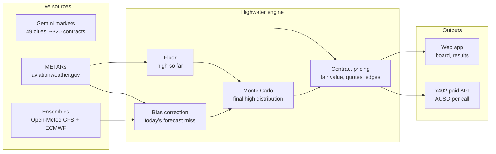
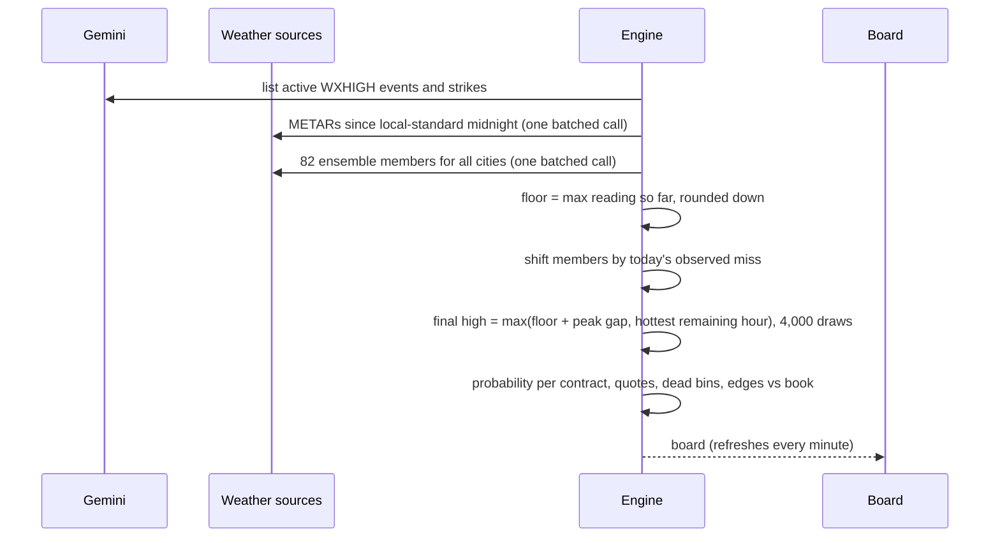
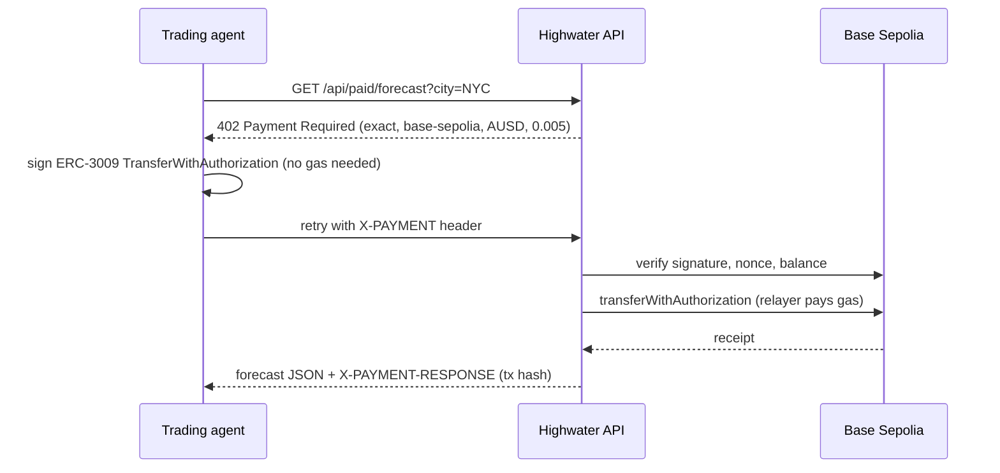

<div align="center">

# Highwater

**Where will today's high land?** Highwater prices every **Gemini daily high temperature contract** live, across 49 US
cities, by combining what the thermometer has **already recorded today** with **82 forecast ensemble members** for the
rest of the day. Trading agents can buy each forecast **per call over x402, paid in AUSD**.

<br/>


<br/>

</div>

---

**Hackathon:** B@BHacks 2.0 (Blockchain@Berkeley, SF Tech Week)<br/>
**Tracks:** Most Technically Impressive · Best Use of Gemini Prediction API · Best Use of AUSD<br/>
**Team:** Volodymyr Borysenko<br/>
**Live demo:** [highwater-tau.vercel.app](https://highwater-tau.vercel.app)

| Page | What you'll find |
|------|------------------|
| [Overview](https://highwater-tau.vercel.app) | What Highwater does, with one live city |
| [Live board](https://highwater-tau.vercel.app/board) | All 49 cities on a map, search, filters, full contract detail |
| [Results](https://highwater-tau.vercel.app/results) | Scores on settled Gemini markets, calibration, caveats |
| [For developers](https://highwater-tau.vercel.app/developers) | Pay-per-forecast API over x402, live agent demo |
| [Labs](https://highwater-tau.vercel.app/labs) | Experiment: Gemini sandbox crypto contracts |

---

## The Problem

Gemini lists a daily high temperature market for **49 US cities**, about **320 contracts a day**. On a typical afternoon
only a **handful have a bid or an ask**. Late in the day, most of them are close to decided: if Chicago has already hit
78°F, every range below 78 is dead, but nobody is pricing that.

Forecast-based weather bots exist (mostly for Kalshi), but a forecast alone keeps giving weight to outcomes that can no
longer happen. **Highwater conditions on what has already been observed.** The official high can never finish below the
highest reading so far, so it combines that floor with the forecast for the remaining hours and prices every contract,
including the empty books.

---

## Built With

| Area | Stack |
|------|-------|
| **App** | Next.js 16 (App Router) · React 19 · TypeScript · Tailwind CSS 4 |
| **Model** | Monte Carlo over 82 GFS + ECMWF ensemble members · empirical peak correction · bias from today's observations |
| **Markets** | Gemini Prediction Markets API (public data, HMAC-signed sandbox orders) |
| **Weather data** | aviationweather.gov METARs · Open-Meteo ensembles · api.weather.gov stations · Iowa Environmental Mesonet (CLI + ASOS archives) |
| **Payments** | x402 (v1, `exact`) · Agora AUSD (ERC-3009) on Base Sepolia · viem · `x402-fetch` · Blockscout |
| **Map** | d3-geo · topojson · us-atlas |
| **Hosting** | Vercel |

---

## Architecture at a Glance



### One pricing cycle



### Paying for a forecast (x402 + AUSD)



---

## How It Works

Each contract settles on the **NWS Daily Climatological Report** (CLI) for one station. The climate day runs midnight to
midnight **local standard time**, even during daylight saving.

1. **The floor.** All METARs (routine and special) since the start of the climate day, plus the synoptic 6-hour max
   groups, give the highest reading so far. The official high cannot finish below it, so every bin under it is dead.
2. **The rest of the day.** 82 ensemble members (GFS 31 + ECMWF 51) cover the remaining hours. Each one is shifted by
   today's observed forecast miss, recency weighted. Error grows with lead time.
3. **The unobserved peak.** ASOS records its max from continuous data, so the official high often beats the hottest
   METAR by a degree. That gap comes from an empirical distribution measured on last month's reports.
4. **Price it.** Final high = max(high so far + peak gap, hottest remaining hour), simulated 4,000 times and rounded to
   whole °F. That gives a probability per contract, two-sided quotes with spread scaled by uncertainty, and flags where
   the Gemini book is at least 5¢ from fair.

Before about noon the observed max says little, so the engine blends from the forecast-only distribution (9:00) to the
full nowcast (12:00). The backtest below shows why.

---

## Results

### On real, settled Gemini markets

`scripts/realcontracts.ts` replays **978 settled Gemini markets** (one per city per day) across **49 cities**,
2026-09-21 to 2026-10-10. Each day is rebuilt as of a local hour using only the METARs available then, and scored
against the contract Gemini actually settled YES. Lower Brier is better.

| As of | Highwater | Floor only | Forecast only | Avg. probability on the winner (Highwater vs forecast) |
|-------|-----------|------------|---------------|--------------------------------------------------------|
| 12:00 | **0.427** | 0.450 | 0.477 | 56% vs 50% |
| 15:00 | **0.338** | 0.390 | 0.477 | 65% vs 50% |
| 18:00 | **0.306** | 0.377 | 0.477 | 70% vs 50% |

"Floor only" just cuts the forecast distribution at the high so far. It explains about half of the gain.

- **Impossible means impossible.** Of 2,345 contracts the floor ruled out, all 2,345 settled NO. Rounding the METAR
  max instead of truncating it produced one wrong call (Anchorage, 2026-10-04), so the engine truncates.
- **The right thermometer.** For all 49 cities, the official high at our mapped station falls in the contract Gemini
  settled YES on every day checked. Nearby stations don't: LaGuardia matches NYC 15% of the time, O'Hare matches
  Chicago 50%.

### Longer window, including mornings

`scripts/backtest.ts` covers 2026-09-10 to 2026-10-10 at 12 stations (371 station-days) on synthetic 2°F bins. It also
produces the calibration curve and the parameters the live engine uses. At 9:00 the nowcast scores **worse** than the
forecast (Brier 0.547 vs 0.489), which is why the live engine blends toward the forecast until noon.

**Caveats.** The historical forecasts are stitched short-lead runs, which flatters the forecast-only baseline. The
forecast-only spread and the peak distribution were fitted on the same days. These are replays, not live trading results.

---

## Agent API: Pay per Forecast in AUSD

Trading bots don't want a subscription. They want one number right before they quote. Highwater sells each forecast per
call over [x402](https://x402.org), paid in Agora's **AUSD** on **Base Sepolia**.

| Endpoint | Price | Returns |
|----------|-------|---------|
| `GET /api/paid/forecast?city=NYC` | 0.005 AUSD | distribution of the final high, fair value per contract, Gemini's book |
| `GET /api/paid/board` | 0.05 AUSD | the same for all 49 cities |

1. **Ask.** An unpaid request gets `402 Payment Required` with standard x402 v1 requirements: scheme `exact`, network
   `base-sepolia`, asset AUSD (`0xa9012a055bd4e0eDfF8Ce09f960291C09D5322dC`), EIP-712 domain `Agora Dollar` / `1`.
2. **Sign.** The agent signs an ERC-3009 `TransferWithAuthorization`. It needs no ETH, only AUSD.
3. **Verify.** Highwater checks the signature, recipient, amount, validity window, unused nonce and balance.
4. **Settle.** Highwater submits `transferWithAuthorization` from its relayer wallet, waits for the receipt, then
   returns the data with an `X-PAYMENT-RESPONSE` header carrying the transaction hash.

Any stock x402 client works. `scripts/agent.ts` uses `x402-fetch` unchanged, and the
[developer page](https://highwater-tau.vercel.app/developers) has a live "Run the demo agent" button. The revenue panel
reads AUSD transfers into the treasury from Base Sepolia's Blockscout, so every payment it shows is on-chain.

---

## Labs: Gemini Sandbox

Gemini's sandbox lists crypto and commodity contracts but no weather markets. The Labs page applies the same question,
where will it land at expiry, to the sandbox's crypto price contracts using Gemini spot and 2-hour realized volatility.
Order buttons work only where a sandbox API key is configured.

---

## Run It

```bash
npm install
npm run dev                         # http://localhost:3000
npx tsx scripts/backtest.ts         # synthetic-bin backtest -> public/backtest.json (~35s)
npx tsx scripts/realcontracts.ts    # settled Gemini markets -> public/realcontracts.json (~45s)
```

The weather side needs no keys. Optional settings in `.env.local` (test wallets only):

```bash
# x402 / AUSD on Base Sepolia
X402_PAY_TO=0x...        # treasury address
X402_RELAYER_KEY=0x...   # pays gas for settlement
AGENT_KEY=0x...          # demo buyer

# Gemini sandbox trading (Labs)
GEMINI_API_KEY=...
GEMINI_API_SECRET=...
```

```bash
npx tsx --env-file=.env.local scripts/fund-agent.ts                       # faucet AUSD to the agent
npx tsx --env-file=.env.local scripts/agent.ts http://localhost:3000 NYC CHI MIA
```

---

## Code Map

| Path | What |
|------|------|
| `src/app/` | Pages (`/`, `/board`, `/results`, `/developers`, `/labs`) and API routes |
| `src/lib/markets.ts` | Gemini weather events and bin parsing (`LO75`, `76TO77`, `HI86`) |
| `src/lib/stations.ts` | City code to NWS station, climate-day window in standard time |
| `src/lib/obs.ts` | METAR parsing (T-group, 6-hour max), high so far |
| `src/lib/forecast.ts` | Batched GFS + ECMWF ensemble fetch |
| `src/lib/engine.ts` | Bias, Monte Carlo, blend, bin probabilities, quotes |
| `src/lib/board.ts` | Builds the 49-city board from all sources |
| `src/lib/x402.ts` | x402 paywall: requirements, ERC-3009 verify, on-chain settlement |
| `src/lib/crypto.ts`, `src/lib/gemini-trade.ts` | Labs: sandbox pricing and HMAC-signed orders |
| `scripts/lib-replay.ts` | Shared replay: data loading, models, scoring |
| `scripts/realcontracts.ts` | Scoring on settled Gemini markets, station-map check |
| `scripts/backtest.ts` | Longer backtest, calibration, parameter estimates |
| `scripts/agent.ts` | Trading agent that buys forecasts over x402 |

---

## Limits

- The city-to-station map follows the airport code, with explicit exceptions (Central Park for NYC, Midway for
  Chicago). It is verified against about 20 days of Gemini settlements per city.
- Gemini's sandbox has no weather markets, so weather quotes are shown, not posted.
- Payments run on Base Sepolia testnet.
- Not financial advice.
